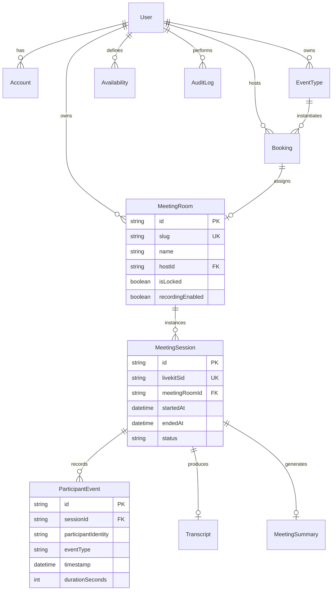

# MHAF Live — Database Schema & Data Model Specification

**Document Version:** 1.0.0  
**Database Engine:** PostgreSQL 15+  
**ORM / Data Layer:** Prisma Client  
**Status:** Approved for Implementation  

---

## 1. Entity Relationship Overview

The MHAF Live data architecture models five cohesive domains:
1. **Identity & Authentication:** Users, accounts, roles, and profiles.
2. **Scheduling Infrastructure:** Event types, working availability, and booking records.
3. **Real-Time Video Rooms:** Static room configurations, active sessions, and live state.
4. **Attendance & Event Logging:** Granular participant lifecycles, join/leave timestamps, and duration heatmaps.
5. **Meeting Intelligence:** Cloud recording assets, transcripts, and structured AI summaries.



---

## 2. Complete Prisma Schema (`prisma/schema.prisma`)

```prisma
datasource db {
  provider = "postgresql"
  url      = env("DATABASE_URL")
}

generator client {
  provider = "prisma-client-js"
}

// ==========================================
// 1. Identity & Access Control Domain
// ==========================================

enum UserRole {
  ADMIN
  HOST
  MEMBER
}

model User {
  id            String    @id @default(cuid())
  name          String?
  email         String    @unique
  emailVerified DateTime?
  image         String?
  passwordHash  String?
  role          UserRole  @default(HOST)
  timezone      String    @default("UTC")
  createdAt     DateTime  @default(now())
  updatedAt     DateTime  @updatedAt

  accounts      Account[]
  sessions      Session[]
  eventTypes    EventType[]
  availabilities Availability[]
  hostedBookings Booking[]       @relation("HostBookings")
  meetingRooms  MeetingRoom[]   @relation("HostRooms")
  auditLogs     AuditLog[]      @relation("UserAuditLogs")

  @@index([email])
}

model Account {
  id                String  @id @default(cuid())
  userId            String
  type              String
  provider          String
  providerAccountId String
  refresh_token     String? @db.Text
  access_token      String? @db.Text
  expires_at        Int?
  token_type        String?
  scope             String?
  id_token          String? @db.Text
  session_state     String?

  user User @relation(fields: [userId], references: [id], onDelete: Cascade)

  @@unique([provider, providerAccountId])
  @@index([userId])
}

model Session {
  id           String   @id @default(cuid())
  sessionToken String   @unique
  userId       String
  expires      DateTime
  user         User     @relation(fields: [userId], references: [id], onDelete: Cascade)

  @@index([userId])
}

model VerificationToken {
  identifier String
  token      String   @unique
  expires    DateTime

  @@unique([identifier, token])
}

// ==========================================
// 2. Scheduling & Booking Domain (Cal.diy Pattern)
// ==========================================

model EventType {
  id              String   @id @default(cuid())
  slug            String
  title           String
  description     String?  @db.Text
  durationMinutes Int      @default(30)
  bufferBeforeMin Int      @default(0)
  bufferAfterMin  Int      @default(10)
  isActive        Boolean  @default(true)
  hostId          String
  createdAt       DateTime @default(now())
  updatedAt       DateTime @updatedAt

  host     User      @relation(fields: [hostId], references: [id], onDelete: Cascade)
  bookings Booking[]

  @@unique([hostId, slug])
  @@index([hostId, isActive])
}

model Availability {
  id           String   @id @default(cuid())
  userId       String
  dayOfWeek    Int      // 0 = Sunday, 1 = Monday, ..., 6 = Saturday
  startTime    String   // Format "HH:mm" e.g. "09:00"
  endTime      String   // Format "HH:mm" e.g. "17:00"
  timezone     String   @default("UTC")
  createdAt    DateTime @default(now())
  updatedAt    DateTime @updatedAt

  user User @relation(fields: [userId], references: [id], onDelete: Cascade)

  @@index([userId, dayOfWeek])
}

enum BookingStatus {
  PENDING
  CONFIRMED
  CANCELLED
  COMPLETED
}

model Booking {
  id             String        @id @default(cuid())
  uid            String        @unique @default(cuid())
  eventTypeId    String
  hostId         String
  attendeeName   String
  attendeeEmail  String
  attendeeNotes  String?       @db.Text
  startTime      DateTime
  endTime        DateTime
  status         BookingStatus @default(CONFIRMED)
  meetingRoomId  String?       @unique
  createdAt      DateTime      @default(now())
  updatedAt      DateTime      @updatedAt

  eventType   EventType    @relation(fields: [eventTypeId], references: [id], onDelete: Restrict)
  host        User         @relation("HostBookings", fields: [hostId], references: [id], onDelete: Cascade)
  meetingRoom MeetingRoom? @relation(fields: [meetingRoomId], references: [id], onDelete: SetNull)

  @@index([hostId, startTime, endTime])
  @@index([attendeeEmail])
  @@index([status])
}

// ==========================================
// 3. Real-Time Meeting Room Domain (LiveKit)
// ==========================================

model MeetingRoom {
  id               String   @id @default(cuid())
  slug             String   @unique
  name             String
  hostId           String
  isLocked         Boolean  @default(false)
  recordingEnabled Boolean  @default(false)
  emptyTimeoutSec  Int      @default(300)
  maxParticipants  Int      @default(50)
  livekitRoomName  String   @unique
  createdAt        DateTime @default(now())
  updatedAt        DateTime @updatedAt

  host     User             @relation("HostRooms", fields: [hostId], references: [id], onDelete: Cascade)
  booking  Booking?
  sessions MeetingSession[]

  @@index([hostId])
  @@index([slug])
}

enum SessionStatus {
  ACTIVE
  FINISHED
  FAILED
}

model MeetingSession {
  id             String        @id @default(cuid())
  meetingRoomId  String
  livekitSid     String        @unique // LiveKit Room SID
  startedAt      DateTime      @default(now())
  endedAt        DateTime?
  status         SessionStatus @default(ACTIVE)
  recordingUrl   String?       @db.Text
  egressId       String?
  createdAt      DateTime      @default(now())
  updatedAt      DateTime      @updatedAt

  meetingRoom       MeetingRoom        @relation(fields: [meetingRoomId], references: [id], onDelete: Cascade)
  participantEvents ParticipantEvent[]
  transcript        Transcript?
  summary           MeetingSummary?

  @@index([meetingRoomId, startedAt])
  @@index([status])
}

// ==========================================
// 4. Attendance & Event Logging Domain
// ==========================================

enum ParticipantEventType {
  JOINED
  LEFT
  RECONNECTED
  MUTED_BY_HOST
  DISCONNECTED
}

model ParticipantEvent {
  id                  String               @id @default(cuid())
  sessionId           String
  participantIdentity String               // User ID or Guest UUID
  participantName     String
  isHost              Boolean              @default(false)
  eventType           ParticipantEventType
  timestamp           DateTime             @default(now())
  durationSeconds     Int?                 // Populated on LEFT event
  metadataJson        Json?                // Browser info, network quality metrics

  session MeetingSession @relation(fields: [sessionId], references: [id], onDelete: Cascade)

  @@index([sessionId, participantIdentity])
  @@index([sessionId, eventType])
  @@index([timestamp])
}

// ==========================================
// 5. Intelligence, Transcript & Summary Domain
// ==========================================

model Transcript {
  id             String   @id @default(cuid())
  sessionId      String   @unique
  rawAudioUrl    String?
  rawText        String   @db.Text
  segmentsJson   Json     // Array of { speaker, startMs, endMs, text }
  wordCount      Int
  confidenceRate Float
  createdAt      DateTime @default(now())

  session MeetingSession @relation(fields: [sessionId], references: [id], onDelete: Cascade)
}

model MeetingSummary {
  id             String   @id @default(cuid())
  sessionId      String   @unique
  overview       String   @db.Text
  keyTakeaways   Json     // String array of points
  actionItems    Json     // Array of { item, assignee, priority }
  sentimentScore Float?
  metricsJson    Json     // Heatmap data & participation distribution stats
  createdAt      DateTime @default(now())

  session MeetingSession @relation(fields: [sessionId], references: [id], onDelete: Cascade)
}

// ==========================================
// 6. Security & Audit Logging
// ==========================================

model AuditLog {
  id             String   @id @default(cuid())
  actorId        String?
  action         String   // e.g. "ROOM_LOCKED", "TOKEN_MINTED", "RECORDING_DOWNLOADED"
  targetResource String   // e.g. "MeetingRoom:cuid123"
  ipAddress      String?
  userAgent      String?
  timestamp      DateTime @default(now())

  actor User? @relation("UserAuditLogs", fields: [actorId], references: [id], onDelete: SetNull)

  @@index([actorId, timestamp])
  @@index([action])
}
```

---

## 3. Database Indexes & Query Optimization Strategy

1. **High-Frequency Booking Queries:**
   - Query: Checking available slots and detecting booking collisions.
   - Index: `@@index([hostId, startTime, endTime])` on `Booking` enables sub-millisecond B-tree interval lookups during schedule resolution.
2. **Real-Time Attendance Reconciliation:**
   - Query: Aggregating participant events when generating heatmaps.
   - Index: `@@index([sessionId, participantIdentity])` on `ParticipantEvent` ensures rapid timeline segment grouping.
3. **Room Token Authorization:**
   - Query: Resolving room permissions by slug on incoming WebRTC requests.
   - Index: `@@unique([slug])` on `MeetingRoom` provides instantaneous $O(1)$ lookups.

---

## 4. Authorization & Row-Level Access Matrix

| Resource / Action | Anonymous Guest | Authenticated Attendee | Meeting Host | Admin |
| :--- | :--- | :--- | :--- | :--- |
| **View Landing & Schedule Demo** | ✓ Read / Submit | ✓ Read / Submit | ✓ Read / Submit | ✓ Read / Submit |
| **View Host Public Booking Page** | ✓ View Slots | ✓ View Slots | ✓ View Slots | ✓ View Slots |
| **Book Time Slot** | ✓ (Supply name/email) | ✓ Confirmed | ✓ Confirmed | ✓ Confirmed |
| **Enter PreJoin Room** | ✓ (With invite link) | ✓ (With invite link) | ✓ Full Control | ✓ Full Control |
| **Mint LiveKit Token** | ✓ (`canPublish: true`) | ✓ (`canPublish: true`) | ✓ (`roomAdmin: true`)| ✓ (`roomAdmin: true`)|
| **Mute / Kick Participant** | ✗ Denied | ✗ Denied | ✓ Allowed | ✓ Allowed |
| **Access In-Meeting Chat** | ✓ Ephemeral | ✓ Ephemeral | ✓ Ephemeral | ✓ Ephemeral |
| **View Attendance Heatmap** | ✗ Denied | ✗ Denied | ✓ Own Meetings | ✓ All Meetings |
| **View Transcripts & Summaries**| ✗ Denied | Optional (if shared) | ✓ Full Access | ✓ Full Access |
| **Manage Event Types / Avail** | ✗ Denied | ✗ Denied | ✓ Own Schedules | ✓ All Schedules |
