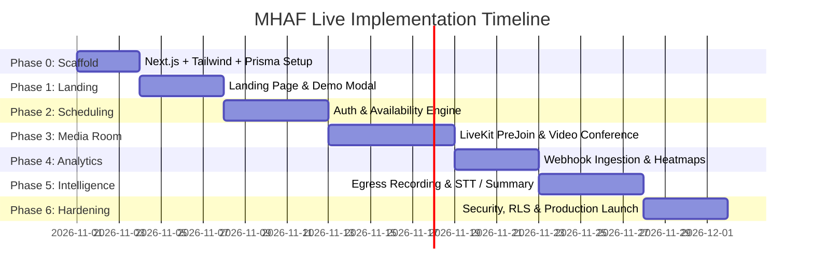

# MHAF Live — Phased Implementation Roadmap & Execution Plan

**Document Version:** 1.0.0  
**Status:** Ready for Execution Approval  
**Target Architecture:** Next.js App Router (TypeScript) + LiveKit SFU + PostgreSQL (Prisma) + Tailwind CSS / shadcn/ui  

---

## 1. Architectural Strategy & Guiding Principles

1. **Clean Foundation First:** Avoid monolithic forks or blindly copying upstream templates. Build a tailored Next.js App Router architecture extracting proven primitives from each audited reference.
2. **Strict Licensing Compliance:** Retain MIT notices for `shadcn-dashboard-landing-template`, `cal.diy`, and `morluto/rea`, and preserve Apache-2.0 notices for adapted `livekit-examples/meet` components.
3. **Verified Milestones:** Every phase concludes with explicit, measurable acceptance criteria before proceeding. No feature (especially transcription or analytics) is deemed operational until verified in an end-to-end test.
4. **Zero Unapproved Production Deployments:** All local developments operate against mockable or containerized environments (Docker PostgreSQL, MinIO S3, LiveKit Cloud development sandbox) before production cloud infrastructure is provisioned.

---

## 2. Phased Rollout Schedule

---

### Phase 0: Foundation & Environment Scaffolding
* **Objectives:**
  - Initialize clean Next.js 15+ App Router project with TypeScript and strict ESLint configuration.
  - Configure Tailwind CSS v4 and install core `@radix-ui` / `shadcn/ui` utilities (`clsx`, `tailwind-merge`, `class-variance-authority`, `lucide-react`).
  - Initialize Prisma with PostgreSQL schema from `docs/data-model.md`.
  - Establish environment variable contract (`.env.example`).
* **Deliverables:**
  - Compiling Next.js application at `http://localhost:3000`.
  - Initialized Prisma client with local PostgreSQL migrations.
* **Acceptance Criteria:**
  - `pnpm build` passes with zero TypeScript errors or unresolved module warnings.
  - `pnpm prisma db push` successfully provisions database tables.

---

### Phase 1: Public Marketing Surface & Request-Demo Flow
* **Objectives:**
  - Implement full landing page per `docs/landing-page-spec.md`.
  - Build Announcement Bar, Sticky Glass Header, Responsive Mobile Drawer, and Dark/Light Mode Theme Provider.
  - Construct Hero Section with interactive meeting room mockup visualizer.
  - Implement Bento Grid feature pillars and Tier Comparison table.
  - Build Request Demo Modal with Zod form validation and server action logging.
* **Deliverables:**
  - High-conversion responsive landing page at `/`.
  - Functional Request Demo lead submission pipeline.
* **Acceptance Criteria:**
  - Mobile responsiveness verified at 375px (iPhone SE), 768px (Tablet), and 1440px (Desktop).
  - All interactive elements meet $\ge 44 \times 44\text{px}$ touch target standards.
  - Request Demo form handles validation errors gracefully and confirms submission.

---

### Phase 2: Host Authentication & Scheduling Engine
* **Objectives:**
  - Implement NextAuth.js credentials and OAuth session providers.
  - Build Host Dashboard shell (`/dashboard`) with navigation tabs (`Upcoming Meetings`, `Schedule Settings`, `Recordings`, `Analytics`).
  - Implement Availability Schedule manager (`/dashboard/availability`) allowing hosts to configure daily operating windows and buffer periods.
  - Build public booking route (`/[hostSlug]/[eventSlug]`) calculating open slots without collisions.
  - Implement atomic slot reservation and automatic meeting room slug assignment.
* **Deliverables:**
  - Complete calendar booking workflow inspired by `cal.diy`.
  - Automated transactional email confirmations with `.ics` calendar invites.
* **Acceptance Criteria:**
  - Verified conflict detection: Two simultaneous booking attempts on the exact same time slot reject the second attempt atomically.
  - Timezone conversion correctly displays UTC availability in attendee's local timezone.

---

### Phase 3: Real-Time LiveKit Video Room & PreJoin Staging
* **Objectives:**
  - Integrate `@livekit/components-react`, `@livekit/components-styles`, and `livekit-server-sdk`.
  - Implement server route `/api/connection-details` verifying room status, booking validity, and signing temporary LiveKit JWT tokens.
  - Implement custom PreJoin screen at `/rooms/[slug]`:
    - Device enumeration (Camera, Mic, Speaker).
    - Live audio level meter visualization using browser AudioContext.
    - Name entry and device preference storage.
  - Build Conference Room view:
    - Active speaker dynamic grid.
    - Screen-sharing track renderer.
    - Media control bar (Mute, Camera, Share Screen, Leave).
    - WebRTC reliable data-channel in-meeting chat.
    - Host controls (Mute participant, Kick participant, Lock room).
* **Deliverables:**
  - Fully functional multi-party video conferencing room.
* **Acceptance Criteria:**
  - WebRTC connection connects within $\le 1500\text{ms}$ on standard broadband.
  - Audio and video mute/unmute states propagate to all connected peers in real time.
  - In-room chat messages delivered across WebRTC data channels with zero server polling.

---

### Phase 4: Lifecycle Logging, Webhooks & Attendance Analytics
* **Objectives:**
  - Implement secure webhook endpoint at `/api/livekit/webhook` using `WebhookReceiver` with cryptographic signature verification.
  - Ingest `participant_joined`, `participant_left`, and `room_finished` events into `ParticipantEvent` and `MeetingSession` tables.
  - Build Attendance Analytics dashboard at `/dashboard/meetings/[sessionId]/analytics`:
    - Aggregate net attendance duration per participant.
    - Render interactive presence heatmap (60-second time bins visual timeline).
    - Display audio participation percentages.
* **Deliverables:**
  - Verifiable participant session audit trail.
  - Attendance heatmap data visualization.
* **Acceptance Criteria:**
  - Simulated network disconnect correctly records `LEFT` and subsequent `RECONNECTED` events without duplicating user count.
  - Attendance heatmap displays accurate timeline blocks matching physical connection periods.

---

### Phase 5: Audio Archival Egress, Transcription & AI Intelligence
* **Objectives:**
  - Configure LiveKit Egress service to capture room composite audio stream to S3 storage bucket upon call completion.
  - Implement asynchronous queue worker listening for `egress_ended` webhook.
  - Integrate Speech-to-Text provider (OpenAI Whisper API or Deepgram) to generate speaker-diarized text transcripts.
  - Feed diarized transcript to LLM processor to generate:
    - Executive Overview
    - Topic Highlights
    - Structured Action Items with assignees.
  - Render transcript reader and summary panel at `/dashboard/meetings/[sessionId]/summary`.
* **Deliverables:**
  - Automated meeting recording and post-call intelligence pipeline.
* **Acceptance Criteria:**
  - Audio egress successfully uploads valid `.m4a` file to S3 bucket.
  - Transcript reflects speaker identities and timeline timestamps.
  - LLM parser outputs valid structured JSON action items.

---

### Phase 6: Hardening, Security Audit & Launch Verification
* **Objectives:**
  - Enforce comprehensive Row-Level Security (RLS) and API authorization policies.
  - Perform stress tests on token minting under high concurrency.
  - Audit against OWASP Top 10 API vulnerabilities (prevent IDOR on meeting recordings, secure webhook endpoints).
  - Verify zero exposure of server secrets, API keys, or private user telemetry.
* **Deliverables:**
  - Production-ready deployment package with Dockerfile and Helm/Docker Compose definitions.
  - Final Verification Audit Report.
* **Acceptance Criteria:**
  - 100% of API endpoints protected by authorization guards.
  - Unauthenticated access to private recordings returns `401 / 403`.

---

## 3. Risk Assessment & Mitigation Strategies

| Risk Identifier | Likelihood | Impact | Mitigation Strategy |
| :--- | :--- | :--- | :--- |
| **R1: WebRTC NAT/Firewall Traversal Failure** | Medium | High | Provision TURN/STUN servers (built into LiveKit Cloud or co-located coturn server for self-hosted instances). |
| **R2: Token Spoofing / Privilege Escalation** | Low | Critical | Tokens minted strictly on server with `livekit-server-sdk`. Browser never possesses API Key or Secret. |
| **R3: Double-Booking Race Conditions** | Medium | High | Atomic database transactions with PostgreSQL row-level locks on overlapping time spans. |
| **R4: High Egress / Recording Processing Costs** | Medium | Medium | Record composite audio (`.m4a`) rather than video by default for transcription; video egress enabled only on explicit demand. |
| **R5: STT Diarization Hallucinations** | Low | Low | Store raw audio alongside diarized transcripts; provide manual transcript correction interface in host dashboard. |

---

## 4. Alternative Architectural Choices Evaluated

1. **LiveKit Components vs. Raw WebRTC (`simple-peer` / `peerjs`):**
   - *Decision:* Adopt `@livekit/components-react`.
   - *Rationale:* Custom WebRTC meshes fail at $\ge 4$ participants due to client upload saturation ($O(N^2)$ mesh). LiveKit SFU handles bandwidth management, simulcast, and dynacast out of the box with production reliability.
2. **Turborepo Monorepo (Cal.com style) vs. Modular Next.js App Router:**
   - *Decision:* Adopt single modular Next.js application.
   - *Rationale:* A full Turborepo with Yarn workspaces introduces unnecessary maintenance friction for MHAF Live's current scope. Clear domain folders (`src/modules/scheduling`, `src/modules/meeting`, `src/modules/analytics`) provide equal modularity with faster builds and simpler deployments.
3. **Real-time Webhook Speech vs. Asynchronous Egress STT:**
   - *Decision:* Adopt asynchronous Egress STT as baseline; design interface for real-time STT streaming.
   - *Rationale:* Verified from source that LiveKit webhooks do not transmit text or audio frames. Egress archival is resilient to network drops and guarantees 100% transcription capture.
