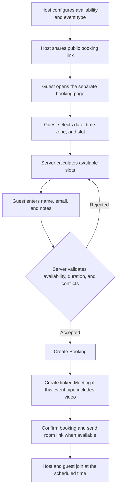
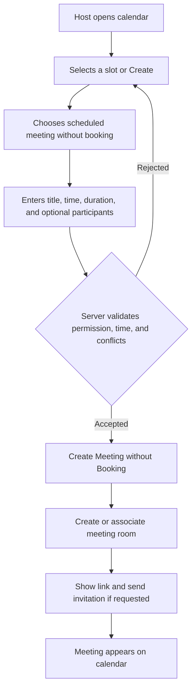
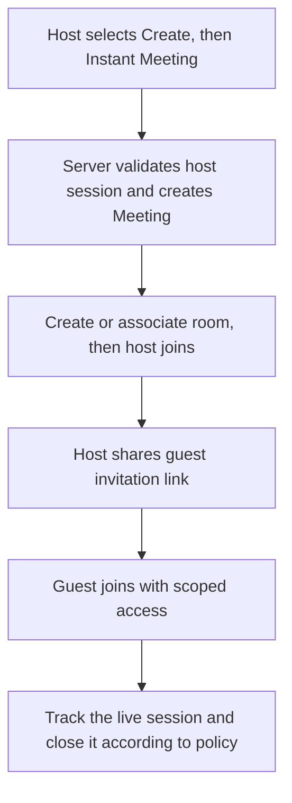

# MHAF Live — Product and UX Direction Draft

**Status:** The product direction is approved for implementation; this note is a reference for detailed review. Implementation work was originally developed on `feat/calendar-workspace-flow`.
**Created:** October 27, 2026
**Scope:** Records product direction and decisions. The draft captures an earlier implementation stage and should not be used as the source of truth for current behavior.

> This note documents the product direction and user journeys designed for the calendar and meeting work. See `docs/architecture.md` and `docs/data-model.md` for the current technical state. Copy and unresolved choices remain open to review.

## 1. Core product concept

MHAF Live is positioned as a **calendar for bookings and meetings**. After sign-in, the calendar is the host's main workspace. The landing page is informational and directs visitors to sign in or create an account; it does not create a real room or meeting.

The public booking link remains a separate guest flow. Hosts configure availability and event types in their account, then share a booking link when needed. From the calendar, a host can manage a meeting linked to a booking, schedule a manual meeting without a booking, or start an instant meeting.

### Product boundaries

- **Landing page:** explain the service and verified features, provide sign-in/registration, and optionally request a demo. No real booking or meeting creation.
- **Host workspace:** calendar, meetings, bookings, event types, availability, and settings.
- **Public booking page:** lets a guest select an available slot for a specific event type.
- **Meeting room:** lets participants join a LiveKit session after the server issues valid access.

## 2. Historical baseline and intended direction

**Historical baseline before the calendar-workspace implementation:**

- The home page `/` included a `RoomLauncher` for instant meetings and quick scheduling through an API, so it was not purely informational.
- `/login`, `/register`, `/dashboard`, `/dashboard/availability`, and `/dashboard/bookings` existed, but there was no calendar view.
- The public booking route `/book/[hostSlug]/[eventSlug]` was separate from the home page. Guests selected a date and slot and submitted their details.
- The meeting room `/rooms/[slug]` included a pre-join screen and code paths for LiveKit token issuance and client connection.
- The earlier implementation used `Booking` records for guest bookings and instant/quick rooms. The Prisma schema included `MeetingRoom` and `MeetingSession`, but no explicit `Meeting` entity for all calendar event types.
- The main application used a JSON store for accounts, bookings, and availability. Prisma/PostgreSQL was present but used separately and in a limited way, such as for demo requests.
- Older landing-page specifications described interactive room creation and features such as analytics and transcription. Some were not implemented or verified, so available features must be distinguished from future concepts.

**Intended direction:**

- The home page creates no records or rooms; real creation starts in the host workspace.
- `/dashboard` becomes the calendar or redirects to it.
- Bookings, meetings, rooms, and sessions are separate concepts, even when related.
- An instant meeting is not represented as a fixed 24-hour booking.

## 3. Shared terminology

| Term | Meaning |
|---|---|
| **Event type** | A bookable template such as “30-minute consultation,” including duration, buffers, and publication rules. It is not a meeting itself. |
| **Booking** | A reserved time slot for a host and guest, usually created through a public booking link. |
| **Meeting** | An event on the host calendar, scheduled or instant, with a status and participants. It may or may not be linked to a booking. |
| **Room** | The LiveKit access resource/link associated with a meeting; it is not the booking. |
| **Meeting session** | An actual live connection in a room, recording participant joins and leaves. |
| **Availability** | The host's recurring working hours in a specified time zone; it is neither a booking nor a room. |

**Design rule:** a booking may create a linked meeting, but each record has a separate responsibility. Not every meeting is a booking, and an instant meeting is not a public appointment.

## 4. Proposed page map

### Public pages

```text
/                              Informational landing page
/login                         Host sign-in
/register                      Host registration
/book/[hostSlug]/[eventSlug]   Public guest booking page
/book/confirmation/[uid]       Booking confirmation and room link, if created
/rooms/[slug]                  Pre-join screen and meeting room
```

### Host account pages

```text
/dashboard                     Calendar or redirect to /dashboard/calendar
/dashboard/calendar            Calendar: weekly first, then daily/monthly
/dashboard/meetings            Upcoming, live, and past meetings
/dashboard/bookings            Bookings and management
/dashboard/event-types         Event types and public booking links
/dashboard/availability        Availability and time zone
/dashboard/settings            Account and meeting settings
/dashboard/meetings/[id]       Meeting details, participants, link, and status
```

**Proposed host navigation:** Calendar, Meetings, Bookings, Event Types, and Availability. Account settings live in a separate menu. On mobile, the calendar is the first destination, with a compact menu for other sections.

The earlier design had `/dashboard` as a summary with links to bookings and availability. Add a separate calendar route only after the page map is approved.

### Landing page after the redesign

- Header with logo, product overview, sign-in, and registration.
- Hero that explains “calendar, bookings, and meetings” rather than starting a room directly.
- Short sections for booking links, calendar management, and video meetings.
- Visual preview only; it does not submit requests or create rooms.
- Primary CTA: sign in or create an account. Optional secondary CTA: request a demo.
- Do not show pricing or claim recording, analytics, or transcription unless those features are confirmed and enabled.

## 5. Calendar “Create” action

The action appears in the host workspace and offers three choices:

1. **Booking appointment:** configure or select an event type and share its public link; or add a booking manually when needed.
2. **Scheduled meeting without a booking:** set a title, date, time, and duration, then optionally add participants or share a link.
3. **Instant meeting:** create a room now and give the host a shareable link.

Do not expose real meeting creation on the landing page. If it retains a widget, it must be clearly visual and must not modify data or issue a live link.

## 6. Proposed user journeys

### A. Guest books from a public link and gets a linked meeting



**Proposed rule:** video event types create a meeting linked to the booking after confirmation. Keep the relationship optional in the data model so non-video bookings or bookings requiring approval can be supported later.

**Server-enforced rules:** the event type exists, is active, and belongs to the host; the slot falls within availability after correct time-zone conversion; duration and buffers match; the notice period is respected; no booking or scheduled meeting conflicts; and the save is atomic so two requests cannot claim the same slot.

### B. Host creates a scheduled meeting without a booking



A manual meeting occupies its calendar time and must prevent a public booking for the same slot. Do not create a synthetic `Booking` record simply because the meeting has a time.

### C. Host starts an instant meeting



An instant meeting **does not create a 24-hour `Booking`** or block a full day on the calendar. If host availability should be blocked during a call, block only the actual session duration or follow a clearly stated policy.

## 7. Proposed data model for review

### Conceptual recommendation

- `EventType`: bookable appointment template.
- `Availability`: host hours and time-zone logic.
- `Booking`: reserved slot, guest details, and booking status; optional link to `Meeting`.
- `Meeting`: event shown on the host calendar, with source `BOOKING | MANUAL | INSTANT`, host, title, start/end, and status.
- `Room`: LiveKit access details associated with a meeting, such as room name and join policy. In an initial version these may be fields on `Meeting` rather than a separate table if the relationship is always one-to-one.
- `MeetingSession`: one or more actual live connections, with start/end and participant events.

This separates **what was booked**, **what is on the calendar**, **the video resource**, and **the actual connection**. The existing schema contains `MeetingRoom` and `MeetingSession`, plus an optional `Booking` relationship to `MeetingRoom`, but field names and responsibilities need clarification before changes. Whether to add an explicit `Meeting` or evolve `MeetingRoom` to represent the calendar event is a later engineering decision; this draft does not change the schema.

## 8. Related documentation

| File | Purpose |
|---|---|
| `docs/README.md` | Documentation index and current-state guide. |
| `docs/product-direction-draft.md` (this file) | Product direction and journeys, including a historical pre-implementation baseline. |
| `docs/landing-page-content-draft.md` | Marketing copy draft and content choices still open for review. |
| `docs/landing-page-spec.md` | Implemented public-page specification and limits. |
| `docs/architecture.md` | Current application architecture, trust boundaries, and operations. |
| `docs/data-model.md` | Active JSON model and its relationship to bookings and meetings. |
| `docs/implementation-roadmap.md` | Verified work, release requirements, and future proposals. |
| `docs/reference-audit.md` | Historical reference-project audit, not the repository's current state. |
| `docs/deploy-vps.md` and `docs/backup-restore.md` | Operations, deployment, and backup procedures; review before a release. |

Sections describing the state before the calendar and meeting work are historical snapshots, not descriptions of current behavior. The current implementation is documented in `docs/architecture.md` and `docs/data-model.md`.

## 9. Implementation and release limits

- The original implementation changes were developed on `feat/calendar-workspace-flow`; consult current source code and the current architecture document for merged behavior.
- Active booking and meeting storage remains a JSON file with a lock inside one Node.js process; do not infer PostgreSQL or multi-replica guarantees.
- Do not describe recording, analytics, transcription, or AI summaries as available unless implemented and verified in the service.
- The decision to promote a **Request a demo** CTA was not part of the original implementation; keep registration and sign-in as the primary public actions unless content review decides otherwise.
- Production deployment is a separate step after review and validation of environment configuration and secrets.
