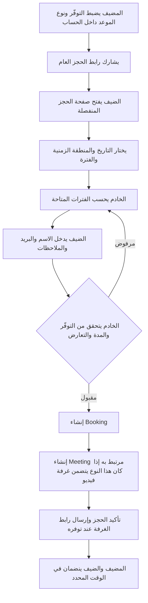
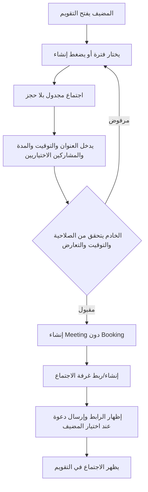
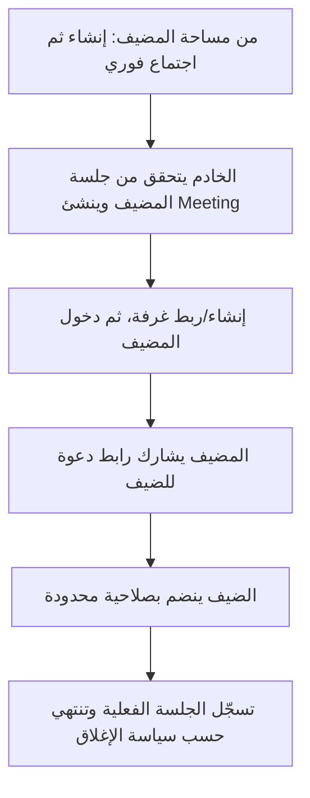

# MHAF Live — مسودة اتجاه المنتج وتجربة الاستخدام

**الحالة:** اتجاه المنتج للتنفيذ معتمد؛ هذه المذكرة مرجعية للمراجعة التفصيلية، والتنفيذ موجود على `feat/calendar-workspace-flow`
**تاريخ الإعداد:** 27 أكتوبر 2026
**النطاق:** توثيق للاتجاه والقرارات؛ التغييرات البرمجية موجودة في الفرع، ولم تُدمج أو تُنشر على الإنتاج.

> توثّق هذه المذكرة اتجاه المنتج وخريطة الاستخدام التي نُفذت على الفرع. راجع `docs/architecture.md` و`docs/data-model.md` للحالة التقنية الحالية؛ تظل التفاصيل النصية والخيارات غير المحسومة قابلة للمراجعة.

## 1. الفكرة الأساسية المقترحة

نوجّه MHAF Live ليكون **تقويمًا للحجوزات والاجتماعات**. التقويم هو مركز العمل للمضيف بعد تسجيل الدخول. أمّا الـLanding Page فهي صفحة تعريف وتسويق فقط: تشرح الخدمة وتوجّه إلى تسجيل الدخول أو إنشاء حساب، ولا تنشئ غرفة أو اجتماعًا حقيقيًا.

يبقى رابط الحجز العام مسارًا منفصلًا للضيف. المضيف يضبط ساعات التوفّر وأنواع المواعيد من داخل حسابه، ثم يشارك رابط الحجز عند الحاجة. ومن داخل التقويم يستطيع إنشاء اجتماع مرتبط بحجز، أو اجتماع مجدول يدويًا بلا حجز، أو اجتماع فوري.

### حدود المنتج

- **Landing Page:** تعريف بالخدمة ومزايا مثبتة، تسجيل الدخول/إنشاء الحساب، وطلب عرض تجريبي اختياري. لا حجز ولا إنشاء اجتماع حقيقي.
- **مساحة المضيف:** التقويم، الاجتماعات، الحجوزات، أنواع المواعيد، ساعات التوفّر، والإعدادات.
- **صفحة الحجز العامة:** للضيف لاختيار فترة متاحة لنوع موعد محدد.
- **غرفة الاجتماع:** مساحة الانضمام إلى جلسة LiveKit بعد إصدار صلاحية صحيحة من الخادم.

## 2. لقطة baseline قبل تنفيذ هذا الفرع والاتجاه المعتمد

**الحالة قبل بدء تنفيذ `feat/calendar-workspace-flow`، حسب مراجعة الكود في هذه المهمة:**

- الصفحة الرئيسية `/` فيها مشغّل اجتماع (`RoomLauncher`) يوفّر بدء اجتماع فوري وجدولة سريعة عبر API. يعني الصفحة الرئيسية حاليًا ليست تعريفية فقط.
- توجد صفحات `/login` و`/register` و`/dashboard` و`/dashboard/availability` و`/dashboard/bookings`، لكن لا توجد صفحة تقويم فعلية.
- صفحة الحجز العامة `/book/[hostSlug]/[eventSlug]` منفصلة عن الصفحة الرئيسية. الضيف يختار تاريخًا وفترة ويقدّم بياناته.
- غرفة الاجتماع `/rooms/[slug]` فيها شاشة ما قبل الدخول، ومسار إصدار LiveKit token واتصال عميل موجودان بالكود.
- في التنفيذ الحالي تُستخدم سجلات `Booking` لتمثيل حجوزات الضيوف وكذلك غرف/اجتماعات فورية أو سريعة. في Prisma schema توجد نماذج `MeetingRoom` و`MeetingSession`، لكن ليس هناك كيان `Meeting` صريح يعبّر عن أحداث التقويم بكل أنواعها.
- الحسابات والحجوزات والتوفّر في التطبيق الرئيسي تعتمد على مخزن JSON بحسب الكود ووثائق التشغيل؛ Prisma/PostgreSQL موجودان لكن استعمالهما الحالي منفصل ومحدود، مثل تخزين طلبات العرض.
- صفحة المواصفات القديمة للـLanding تعرض أزرار بدء اجتماع وأقسامًا تفاعلية وميزات مثل التحليلات والتفريغ النصي. بعض هذه الميزات غير منفّذة أو غير مثبتة، لذلك يلزم فصل ما هو متوفر عما هو تصوّر مستقبلي.

**المستهدف المقترح:**

- الصفحة الرئيسية لا تنشئ أي بيانات أو غرف؛ كل إنشاء حقيقي يبدأ من مساحة المضيف.
- `/dashboard` يصبح التقويم أو يوجّه إليه.
- الحجز والاجتماع والغرفة والجلسة كيانات/مفاهيم منفصلة، حتى عندما ترتبط.
- لا يُمثَّل الاجتماع الفوري بحجز ثابت مدّته 24 ساعة.

## 3. مصطلحات موحّدة

| المصطلح | المعنى المقترح |
|---|---|
| **نوع الموعد — Event Type** | قالب قابل للحجز مثل «استشارة 30 دقيقة»، وفيه المدة والفواصل وقواعد النشر. لا يمثّل اجتماعًا بحد ذاته. |
| **الحجز — Booking** | تخصيص فترة زمنية لمضيف وضيف، غالبًا عبر رابط حجز عام. |
| **الاجتماع — Meeting** | حدث على تقويم المضيف، مجدول أو فوري، وله حالة ومشاركون. يمكن أن يرتبط بحجز أو لا. |
| **الغرفة — Room** | مورد الاتصال/رابط دخول LiveKit المرتبط باجتماع؛ ليس هو الحجز. |
| **الجلسة — Meeting Session** | فترة اتصال حيّ فعلية داخل الغرفة، تسجّل دخول وخروج المشاركين. |
| **التوفّر — Availability** | ساعات العمل المتكررة للمضيف في منطقة زمنية محددة؛ ليس حجزًا ولا غرفة. |

**قاعدة التصميم:** قد ينشئ الحجز اجتماعًا مرتبطًا به، لكن الحجز والاجتماع يظلان سجلّين بمسؤوليات مختلفة. ليس كل اجتماع حجزًا، وليس كل اجتماع فوريًّا موعدًا عامًا.

## 4. خريطة الصفحات المقترحة

### صفحات عامة

```text
/                              صفحة تعريفية فقط
/login                         دخول المضيف
/register                      إنشاء حساب مضيف
/book/[hostSlug]/[eventSlug]   صفحة حجز عامة للضيف
/book/confirmation/[uid]       تأكيد الحجز ورابط الاجتماع إذا أُنشئ
/rooms/[slug]                  ما قبل الدخول ثم غرفة الاجتماع
```

### صفحات داخل حساب المضيف

```text
/dashboard                     التقويم مباشرة أو تحويل إلى /dashboard/calendar
/dashboard/calendar            التقويم: أسبوعي كبداية، ثم يومي/شهري
/dashboard/meetings            الاجتماعات: قادمة / جارية / سابقة
/dashboard/bookings            الحجوزات وإدارتها
/dashboard/event-types         أنواع المواعيد وروابط الحجز العامة
/dashboard/availability        ساعات التوفّر والمنطقة الزمنية
/dashboard/settings            إعدادات الحساب والاجتماعات
/dashboard/meetings/[id]       تفاصيل اجتماع ومشاركيه ورابطه وحالته
```

**التنقّل المقترح للمضيف:** التقويم، الاجتماعات، الحجوزات، أنواع المواعيد، التوفّر. الحساب والإعدادات في قائمة مستقلة. على الهاتف يكون التقويم الوجهة الأولى، مع قائمة مختصرة للأقسام الأخرى.

في التصميم الحالي، صفحة `/dashboard` ملخص مع روابط للحجوزات والتوفّر؛ لا نضيف مسار تقويم إلا بعد اعتماد الخريطة.

### الـLanding Page بعد إعادة التوجيه

- Header: الشعار، نبذة عن المنتج، الدخول، إنشاء حساب.
- Hero يشرح «تقويم وحجوزات واجتماعات» بدل بدء غرفة مباشرة.
- أقسام مختصرة لشرح: رابط الحجز، إدارة التقويم، الاجتماعات المرئية.
- عرض بصري توضيحي فقط، لا يرسل طلبات ولا ينشئ غرفًا.
- CTA أساسي: «دخول» أو «إنشاء حساب». وCTA ثانوي «طلب عرض» إذا أردت الإبقاء عليه.
- لا نعرض تسعيرًا أو ادعاءات عن التسجيل/التحليلات/التفريغ الآلي إلا إذا كانت مزايا مؤكدة ومفعّلة.

## 5. زر «إنشاء» داخل التقويم

يظهر الإجراء داخل حساب المضيف، ويعرض ثلاثة اختيارات:

1. **موعد عبر الحجز:** المضيف يجهّز نوع الموعد أو يختار نوعًا موجودًا ويشارك الرابط العام؛ أو يضيف حجزًا يدويًا للفترة عند الحاجة.
2. **اجتماع مجدول بلا حجز:** المضيف يحدد عنوانًا وتاريخًا ووقتًا ومدة، ويضيف مشاركين أو يشارك رابطًا.
3. **اجتماع فوري:** تنشأ غرفة الآن ويحصل المضيف على رابط المشاركة.

لا يظهر إجراء إنشاء اجتماع حقيقي في الـLanding Page. إذا بقي فيها Widget، يكون نموذجًا بصريًا صريحًا لا يغيّر بيانات ولا يصدر رابطًا حيًا.

## 6. تدفّقات الاستخدام المقترحة

### A. ضيف يحجز من رابط عام، وينتج عنه اجتماع مرتبط



**قاعدة مقترحة:** أنواع المواعيد المرئية تنشئ اجتماعًا مرتبطًا بالحجز بعد تأكيده. العلاقة تبقى اختيارية في نموذج البيانات حتى نقدر نضيف أنواع حجز لا تحتاج غرفة، أو حجوزات تحتاج تأكيدًا قبل إنشاء رابط الاجتماع.

**قواعد لازم يفرضها الخادم:** نوع الموعد موجود ونشط ويتبع للمضيف؛ الفترة ضمن توفّره بعد تحويل صحيح من المنطقة الزمنية؛ المدة والفواصل مطابقة؛ الإشعار المسبق صحيح؛ ما فماش تعارض مع حجز أو اجتماع مجدول؛ والحفظ ذري حتى لا يُقبل طلبان للفترة نفسها.

### B. المضيف ينشئ اجتماعًا مجدولًا بلا حجز



الاجتماع اليدوي يشغل وقته في التقويم ويجب أن يمنع حجز الفترة نفسها من رابط عام. لا ننشئ سجل Booking مصطنعًا لمجرد أن الاجتماع يحتاج توقيتًا.

### C. المضيف ينشئ اجتماعًا فوريًا



الاجتماع الفوري **لا ينشئ Booking مدته 24 ساعة** ولا يحجب يومًا كاملًا من التقويم. إذا قررنا حجب توفر المضيف أثناء المكالمة، يكون الحجب بحسب مدة الجلسة الفعلية أو سياسة معلنة.

## 7. نموذج البيانات المقترح للمراجعة

### التوصية المفاهيمية

- `EventType`: قالب موعد قابل للحجز.
- `Availability`: ساعات المضيف ومنطق المنطقة الزمنية.
- `Booking`: فترة محجوزة وبيانات الضيف وحالة الحجز؛ رابط اختياري إلى `Meeting`.
- `Meeting`: الحدث الذي يظهر في تقويم المضيف، وفيه المصدر `BOOKING | MANUAL | INSTANT`، المضيف، العنوان، البداية والنهاية، والحالة.
- `Room`: بيانات دخول LiveKit المرتبطة بالاجتماع، مثل اسم الغرفة وسياسة السماح بالدخول؛ يمكن إبقاؤها حقولًا داخل `Meeting` في أول نسخة بدل جدول مستقل إذا كانت العلاقة دائمًا واحدة لواحد.
- `MeetingSession`: اتصال حي فعلي واحد أو أكثر، مع بدايته ونهايته وأحداث المشاركين.

هذا يفصل **ما حُجز** عن **ما سيجري على التقويم** عن **مورد الفيديو** عن **الاتصال الفعلي**. في schema الحالية يوجد `MeetingRoom` و`MeetingSession` وارتباط اختياري من `Booking` إلى `MeetingRoom`، لكن أسماء الحقول ومسؤولياتها تحتاج توضيحًا قبل تغييرها. اختيار إنشاء `Meeting` صريح أو ترقية `MeetingRoom` ليمثل حدث التقويم قرار هندسي لاحق؛ لا تغيير schema في هذه المسودة.

## 8. تنظيم الوثائق الحالية

| الملف | دوره |
|---|---|
| `docs/README.md` | فهرس الوثائق ومصدر الحقيقة للحالة الحالية. |
| `docs/product-direction-draft.md` (هذا الملف) | اتجاه المنتج وخريطة الاستخدام، مع لقطة baseline تاريخية قبل التنفيذ. |
| `docs/landing-page-content-draft.md` | مسودة النسخ التسويقية وخيارات المحتوى التي ما زالت قابلة للمراجعة. |
| `docs/landing-page-spec.md` | مواصفات الصفحة العامة المنفذة وحدودها. |
| `docs/architecture.md` | بنية التطبيق الحالية وحدود الثقة والتشغيل. |
| `docs/data-model.md` | نموذج JSON الفعلي وعلاقته بالحجوزات والاجتماعات. |
| `docs/implementation-roadmap.md` | ما تم التحقق منه وما يلزم قبل الإصدار والأعمال المستقبلية. |
| `docs/reference-audit.md` | تدقيق تاريخي لمشاريع المصدر؛ ليس وصفًا للحالة الحالية للمستودع. |
| `docs/deploy-vps.md` و`docs/backup-restore.md` | إجراءات التشغيل والنشر والنسخ الاحتياطي؛ تُراجع بعد اعتماد release. |

المقاطع التي تصف الحالة قبل إنشاء التقويم والاجتماعات هي لقطة تاريخية وليست وصفًا للحالة الحالية. التطبيق الحالي موثق في `docs/architecture.md` و`docs/data-model.md`.

## 9. حدود التنفيذ والإصدار

- تغييرات الكود والوثائق موجودة على `feat/calendar-workspace-flow`، ولم تُدمج أو تُنشر في الإنتاج.
- يبقى التخزين الفعلي للحجوزات والاجتماعات ملف JSON مع قفل داخل عملية Node.js؛ لا تُستنتج منه ضمانات PostgreSQL أو تعدد النسخ.
- لا تُعرض التسجيلات أو التحليلات أو التفريغ النصي أو ملخصات الذكاء الاصطناعي كميزات متاحة ما لم تُنفذ وتُتحقق على الخدمة.
- قرار ترويج زر **Request a demo** لم يُعتمد ضمن هذه النسخة؛ أبقِ أزرار إنشاء الحساب وتسجيل الدخول كالإجراءات العامة الأساسية إلى حين المراجعة.
- النشر إلى الإنتاج خطوة منفصلة بعد مراجعة PR والتحقق من إعدادات البيئة والأسرار.
